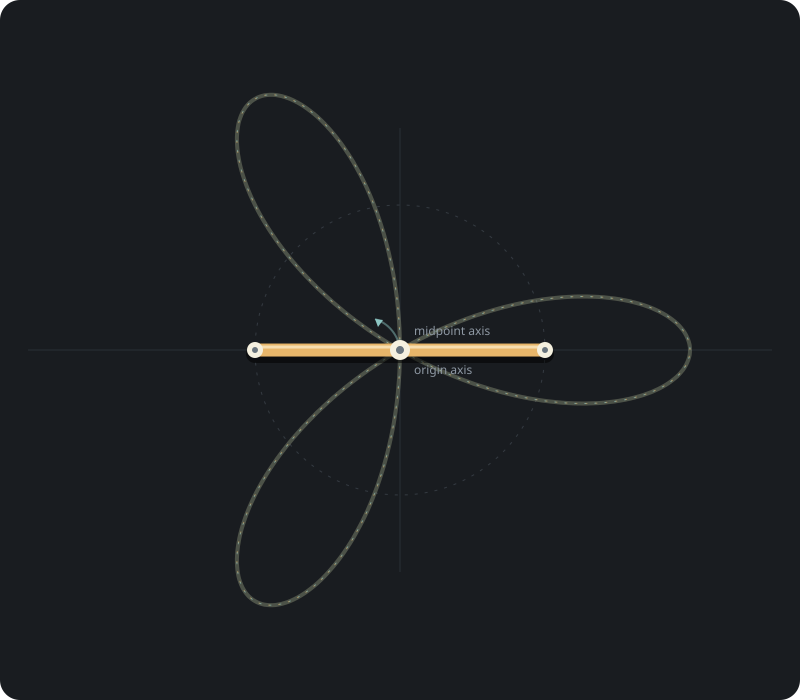
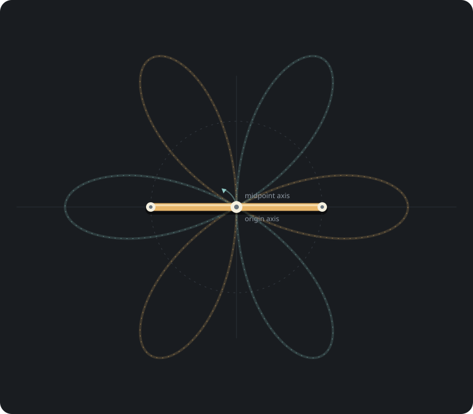
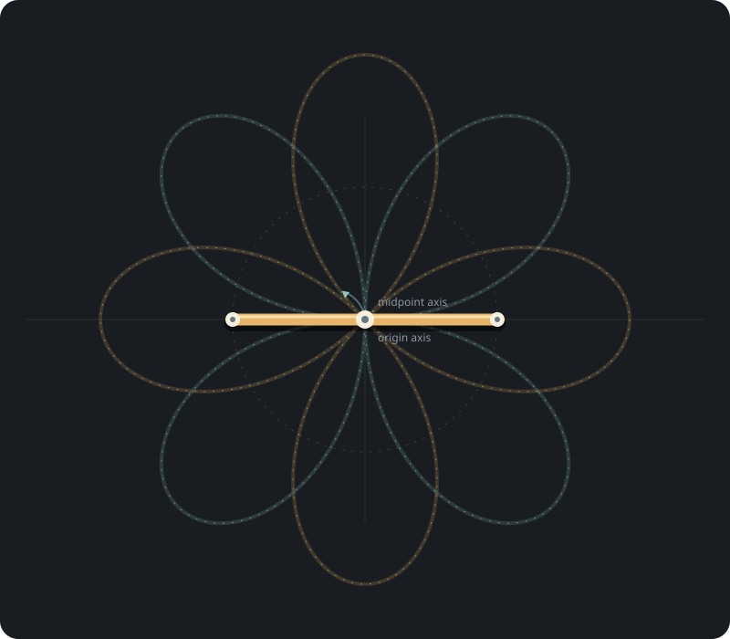
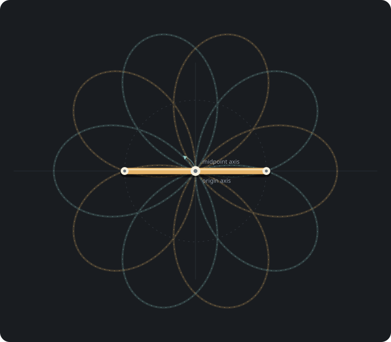

;- [[#Baton]]
- 
### Baton

The ratios here tell how many rotations of the baton occur for each rotation of the arm.  So 2 : 1 is 2 rotations of the baton for 1 rotation of the arm. 

1 : 1

1 : 2

2 : 1

3 : 1

4 : 1

